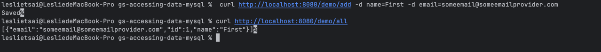
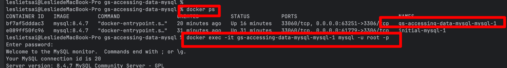
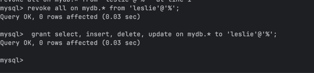

In a banking system, different data technologies can be used to solve different business problems.

**MySQL** is used to persist core business data, such as customer information, bank accounts, and transaction records.

**JPA** simplifies data access by mapping Java objects to relational database tables and reducing repetitive database operations.

**MongoDB** is suitable for storing customer profiles with flexible document structures, especially when different customers have different attributes.

**Redis or GemFire** can be used to store frequently accessed data, such as exchange rates and transaction limits, in memory. This reduces repeated database queries and improves response times.

**Neo4j** is useful for analyzing complex relationships between accounts, such as tracing fund transfers and identifying suspicious connections.

Each technology serves a different purpose, and they can work together within the same banking system.